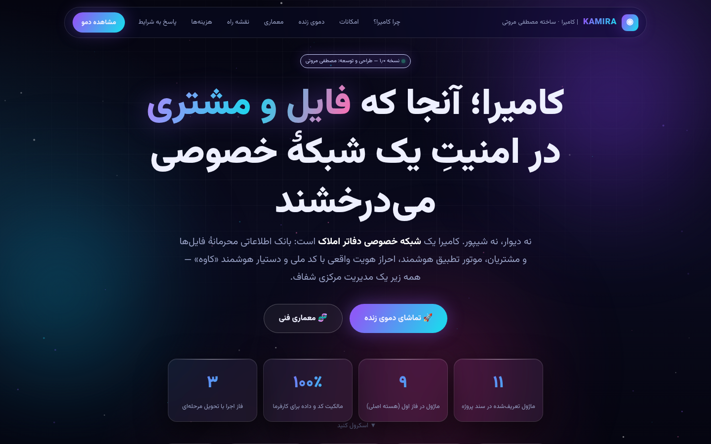

# KAMIRA | کامیرا

**شبکه خصوصی و هوشمند املاک — اپلیکیشن وب تعاملی**

طراحی، توسعه و ساخت: **مصطفی مروتی**



## درباره اپ

کامیرا یک وب‌اپلیکیشن تک‌فایلی و کاملاً خودکفا با رابط شیشه‌ای دارک‌نئون است که پیش‌نمای زنده و قابل تعاملِ پلتفرم خصوصی املاک را اجرا می‌کند:

- 📊 **داشبورد دفتر املاک** — شاخص‌ها، نمودار روند و فید فعالیت‌ها
- 🏦 **بانک خصوصی فایل‌ها** — فیلتر زنده، بج سطح دسترسی، هشدار فایل تکراری
- 👥 **بانک خصوصی مشتریان** — شماره‌های ماسک‌شده و دکمه درخواست مجوز تماس
- 🧠 **موتور تطبیق هوشمند** — اجرای زنده با لاگ اسکن، امتیاز تطبیق و پیشنهاد همکاری بین دفاتر
- 🤖 **دستیار هوشمند کاوه** — چت تعاملی با تایپینگ انیمیشن
- ⚙️ **پنل مدیریت مرکزی** — تأیید/رد فایل‌ها، هشدارهای ضدتقلب، صف احراز هویت
- 🧬 **معماری فنی چندلایه**، نقشه راه ۴ فاز و برآورد هزینه

## اجرا

هیچ نصبی لازم نیست؛ فایل `index.html` را در هر مرورگری باز کنید:

```bash
python3 -m http.server 8000
# سپس http://localhost:8000 را باز کنید
```

یا مستقیم روی فایل دابل‌کلیک کنید.

## دانلود نسخه

آخرین نسخه از بخش [Releases](../../releases) قابل دانلود است:
فایل `KAMIRA-App-v1.0.0.zip` را دریافت کنید، از حالت فشرده خارج کنید و `KAMIRA.html` را در مرورگر باز کنید.

## مشخصات فنی

- تک‌فایل و خودکفا: HTML + CSS + JS بدون وابستگی اجباری خارجی
- واکنش‌گرا (موبایل، تبلت، دسکتاپ) و کاملاً راست‌به‌چپ
- بدون نیاز به بیلد، سرور یا پایگاه داده

## نسخه‌ها

- **v1.0.0** — نسخه اول: رابط شیشه‌ای دارک‌نئون + ماکاپ کامل پنل‌ها

---

© ۱۴۰۵ مصطفی مروتی — تمام حقوق محفوظ است.
